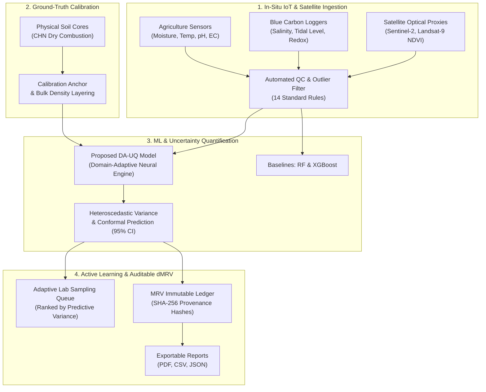
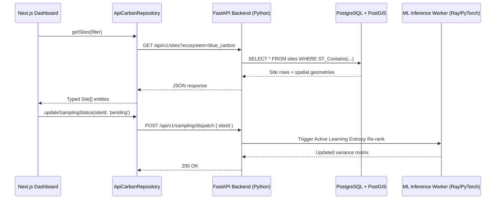

# CarbonMRV Bangladesh (dMRV Dashboard)

> **Research Framework:** *Unified IoT–Machine Learning Framework for Ecosystem-Specific Carbon Stock Estimation and Uncertainty-Aware Digital MRV in Bangladesh.*

[](https://www.typescriptlang.org/)
[](https://nextjs.org/)
[](https://tailwindcss.com/)
[](LICENSE)

---

## ⚠️ Strict Honesty & Disclosure Protocol

1. **Synthetic Demo Data**: All numbers, sensor telemetry, and model outputs presented in this dashboard are generated synthetically for framework demonstration. They are **not field-verified**.
2. **Prohibited Terminology**: This system does **not** issue or claim "verified carbon removal" or tradable "carbon credits". All values are quantified and audited strictly as **estimated carbon stock** ($t\text{ C/ha}$).
3. **Model Performance**: In compliance with research integrity standards, the $R^2$ performance metric for the proposed **DA-UQ** (Domain-Adaptive Uncertainty Quantification) model is strictly designated as **TBD** pending completed multi-season field holdout trials across dynamic Sundarbans and Barind parcels. Baseline model numbers are explicitly labeled as illustrative.

---

## System Overview



---

## Architecture & Component Structure

```
carbonmrv-bangladesh/
├── app/
│   ├── layout.tsx              # Root layout, fonts, navigation AppShell
│   ├── page.tsx                # Overview: KPIs, trend chart, recent MRV feed
│   ├── map/
│   │   └── page.tsx            # Spatial Map: OpenStreetMap tiles, custom SVG markers, filter drawer
│   ├── sites/
│   │   └── [id]/
│   │       └── page.tsx        # Deep Site Detail: 90-day multi-sensor telemetry, soil cores, QC flags
│   ├── models/
│   │   └── page.tsx            # Model Benchmarks: RF vs XGB vs DA-UQ, PICP coverage, holdout error
│   ├── sampling/
│   │   └── page.tsx            # Adaptive Sampling: Active learning queue, budget Pareto frontier
│   ├── ledger/
│   │   └── page.tsx            # Auditable Ledger: Versioned records, 5-step provenance chain, diff modal
│   ├── reports/
│   │   └── page.tsx            # Synthesis Reports: Print-friendly PDF canvas, CSV & JSON downloads
│   └── globals.css             # Tailwind base, print media stylesheet, custom scrollbar
├── components/
│   ├── layout/                 # Collapsible Sidebar, Topbar with honesty badge & ecosystem toggle
│   ├── ui/                     # Accessible cards, badges, glossary tooltips
│   ├── map/                    # Leaflet dynamic wrapper, SVG dual-encoding markers, filter panel
│   ├── charts/                 # Recharts TrendBandChart, SensorTimeSeries, CostUncertainty, Coverage
│   ├── site/                   # SiteDetailDrawer slide-out preview
│   └── ledger/                 # ProvenanceChainView visual nodes, VersionDiffModal
├── types/                      # Comprehensive TypeScript definitions (Sites, Telemetry, Ledger, Models)
├── lib/
│   ├── store.ts                # Zustand global state (ecosystem filter, site selection, search)
│   ├── repository/             # Typed repository interface (swappable with FastAPI/PostgreSQL)
│   └── utils/                  # Formatter, CSV export, active learning ranking, crypto utilities
├── data/
│   └── seedData.json           # 40 synthetic Bangladesh sites (25 Agriculture, 15 Blue Carbon)
└── scripts/
    └── seed.ts                 # Deterministic seed generator script
```

---

## Getting Started

### Prerequisites
- **Node.js**: v18.18.0 or newer (tested on v22.x)
- **npm**: v9.x or newer

### 1. Installation
Clone the repository and install dependencies:
```bash
npm install
```

### 2. Generate Synthetic Seed Data
To regenerate the 40 synthetic sites with 90-day IoT telemetry:
```bash
npm run seed
```

### 3. Run Development Server
Start the local Next.js development server:
```bash
npm run dev
```
Open [http://localhost:3000](http://localhost:3000) in your browser.

### 4. Run Unit Tests
Run unit tests for data utilities and active learning algorithms:
```bash
npm test
```

### 5. Production Build
Verify production compilation:
```bash
npm run build
npm start
```

---

## Key Features & Page Walkthrough

1. **Overview Dashboard (`/`)**:
   - 5 KPI cards tracking monitored sites, mean carbon stock with 95% confidence bounds ($\pm\text{ CI}$), predictive uncertainty width, sensor quality flags, and pending lab samples.
   - Aggregate 6-month carbon stock trajectory chart with shaded 95% predictive ribbon.
   - Side-by-side ecosystem comparison (Barind clay agriculture vs Sundarbans mangrove sediment).

2. **Spatial Map Explorer (`/map`)**:
   - OpenStreetMap canvas centered on Bangladesh ($23.685^\circ\text{N}, 90.356^\circ\text{E}$).
   - Dual-encoding markers: core color encodes stock magnitude; outer ring encodes predictive uncertainty width; pulsing red badge indicates active sensor QC drift flags.
   - Interactive slide-out site detail drawer and multi-dimensional filter panel (ecosystem, uncertainty tier, QC status).

3. **Site Detail & Multi-Stream Telemetry (`/sites/[id]`)**:
   - 90-day continuous IoT telemetry: soil moisture, temperature, pH, EC for farmland; optical salinity, water level, and redox potential for blue carbon.
   - Data completeness meter and automated sensor anomaly alerts.
   - Stratified soil core history calibrated against CHN dry combustion laboratory standards.

4. **Model Comparison & Empirical Coverage (`/models`)**:
   - Strict honesty adherence: DA-UQ $R^2$ designated as **TBD**.
   - Side-by-side metrics: MAE, RMSE, MPIW (interval width), PICP (interval coverage), and spatial holdout error across unseen districts.
   - Prediction interval empirical coverage plot comparing observed soil core measurements against conformalized confidence bands.

5. **Adaptive Lab Sampling Queue (`/sampling`)**:
   - Active learning queue prioritizing sites by model entropy to maximize information gain.
   - Cost vs. Uncertainty-Reduction Pareto frontier curve.
   - Interactive budget slider allocating hypothetical funding (e.g. ৳150,000 BDT) across high-variance sites.
   - Field dispatch modal with confirmation workflow.

6. **Auditable dMRV Ledger (`/ledger`)**:
   - Versioned table with cryptographic SHA-256 hashes for each estimation cycle.
   - Expandable 5-step provenance chain (Raw Ingestion $\rightarrow$ QC Screening $\rightarrow$ Lab Calibration $\rightarrow$ ML Inference $\rightarrow$ Final Stock Estimate).
   - Interactive version diff inspector comparing parameters and uncertainty contractions between version releases ($v1.1$ vs $v1.2$).

7. **Reports & Audit Generator (`/reports`)**:
   - Multi-site scope selector and date range configurator.
   - Executive synthesis with aggregate carbon pool and propagated confidence bounds.
   - Tidy CSV export, machine-readable JSON export, and print-ready PDF stylesheet via browser print.

---

## Next Steps: Connecting a Real Backend & ML API

The frontend has been built with an **Enterprise Repository Pattern** (`CarbonDataRepository` in `lib/repository/interface.ts`). The UI components are completely decoupled from data storage.

To connect a live FastAPI / PostgreSQL backend:



### Steps to Replace the Synthetic Repository:
1. Implement `ApiCarbonDataRepository` in `lib/repository/apiRepository.ts` implementing `CarbonDataRepository`.
2. Swap the export in `lib/repository/index.ts`:
   ```typescript
   import { ApiCarbonDataRepository } from './apiRepository';
   export const repository = new ApiCarbonDataRepository(process.env.NEXT_PUBLIC_API_URL!);
   ```
3. Expose matching FastAPI endpoints:
   - `GET /api/v1/sites`
   - `GET /api/v1/sites/{id}`
   - `GET /api/v1/overview`
   - `GET /api/v1/models/benchmarks`
   - `GET /api/v1/sampling/queue`
   - `POST /api/v1/sampling/dispatch`
   - `GET /api/v1/ledger`

---

## Known Limitations

1. **Synthetic Telemetry**: Telemetry streams are algorithmically generated with seasonal sine waves and gaussian noise rather than live physical LoRaWAN hardware gateways.
2. **Client-Side Map Rendering**: Leaflet uses vector OpenStreetMap tiles without an offline vector mbtiles tile server; an active internet connection is required to render basemap tiles.
3. **Local In-Memory Mutation**: Actions like "Request Lab Sample" update state in client memory and session; persistence requires connecting the PostgreSQL repository.
4. **Browser PDF Export**: The PDF report uses the browser's native `@media print` print engine; for server-side rasterized multi-page PDF generation, integration with Puppeteer or `@react-pdf/renderer` is recommended.
